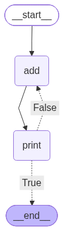

# LangGraph Loop Demo

> **Learning project.** I built this to learn LangGraph basics. It is not production code.

## What it does

A tiny graph with two nodes that loops until a counter passes 12:

1. `add` increments `n` and picks a random letter
2. `print` prints the current state
3. A conditional edge decides: stop at `END` or go back to `add`

## What I learned

1. How to define state with `TypedDict`
2. How nodes, edges and conditional edges work
3. How to build a loop in a graph with a stop condition
4. How to run a graph with `invoke` and visualize it with Mermaid

## How to run

```bash
python -m venv .venv
source .venv/bin/activate   # Windows: .venv\Scripts\activate
pip install -r requirements.txt
python demo.py
```

## Graph


